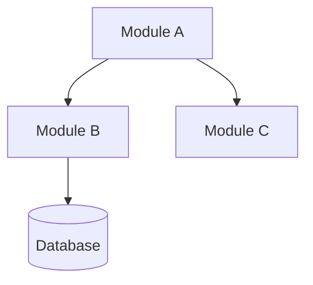
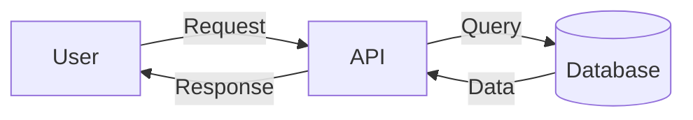
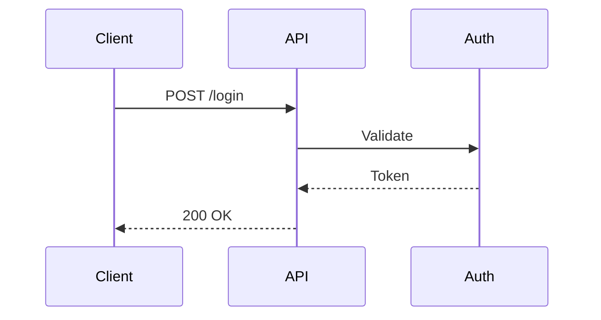

# Blueprint Generation for Framework Development

This skill provides templates and guidance for creating the comprehensive blueprint files that document project architecture, decisions, and implementation plans.

---

## Directory Structure

Initialize this structure at project start:

```
.framework-blueprints/
├── 00-project-state.json          # Master state (see state-schema.json)
├── 01-discovery/
│   ├── outline-v1.md              # Initial high-level outline
│   ├── outline-detailed.md        # Expanded bullet points
│   ├── architecture-diagram.md    # Mermaid + ASCII diagrams
│   ├── decisions-log.md           # Decisions with sources
│   ├── premise-challenge.md       # Premise validation
│   ├── dream-state.md             # Current → Plan → 12-month ideal
│   └── alternatives.md            # Implementation approaches considered
├── 02-structure/
│   ├── module-hierarchy.md        # Complete module breakdown
│   ├── dependency-graph.md        # Module relationships (ASCII + Mermaid)
│   ├── risk-assessment.md         # Risks with confidence scores
│   ├── verbal-links.md            # Connections in plain language
│   └── interaction-states.md      # Loading/empty/error/success/partial table
├── 03-api-planning/
│   ├── api-contracts.md           # All endpoints, schemas (SOURCE OF TRUTH)
│   ├── call-signs.md              # Verified module connections
│   ├── coding-sequence.md         # Task order with dependencies
│   └── scope-challenge.md         # Complexity/search/completeness checks
├── 04-agent-assignment/
│   ├── work-division.md           # How work is split
│   ├── llm-capabilities.md        # Research on each LLM
│   ├── assignment-matrix.md       # Which LLM → which tasks
│   └── prompts/                   # Tailored prompts for each agent
├── 05-execution/
│   ├── handoff-protocol.md        # Standard handoff format
│   ├── progress-tracker.md        # Status dashboard
│   ├── shared-context.md          # Context all agents need
│   ├── test-coverage-diagram.md   # ASCII coverage map with gap analysis
│   ├── state-summary-phase-5.md   # 50% checkpoint summary
│   └── handoffs/                  # Individual handoff files
├── 06-integration/
│   ├── integration-checklist.md   # All verification checks
│   ├── conflict-resolution.md     # Conflicts and resolutions
│   ├── test-plan.md               # Integration tests
│   ├── final-report.md            # Complete project documentation
│   └── review-report.md           # Findings summary with deferred items
└── backups/                       # State file backups
```

---

## File Templates

### 00-project-state.json

Initialize per the canonical schema at `skills/project-state-management/references/state-schema.json` (single source of truth for all field definitions).

---

### File Templates

Templates are in `templates/` directory:
- `templates/outline-template.md` — Project outline structure
- `templates/handoff-template.md` — Agent handoff document
- `templates/progress-tracker-template.md` — Execution dashboard
- `templates/api-contract-template.md` — API endpoint specification

For decisions-log, api-contracts, and final-report: generate from the patterns above using project-specific data. Do not copy example data — populate from actual Phase 1-6 outputs.

---

## Naming Conventions

### Files

| Type | Pattern | Example |
|------|---------|---------|
| Outline | `outline-v{N}.md` | `outline-v1.md` |
| State summary | `state-summary-phase-{N}.md` | `state-summary-phase-5.md` |
| Handoff | `HO-{NNN}-{from}-to-{to}.md` | `HO-001-backend-to-frontend.md` |
| Agent prompt | `{role}-agent.md` | `backend-agent.md` |

### IDs

| Type | Pattern | Example |
|------|---------|---------|
| Decision | `D{NNN}` | `D001` |
| Handoff | `HO-{NNN}` | `HO-001` |
| Risk | `R{NNN}` | `R001` |
| Task | `T-{NNN}` | `T-001` |

---

## Mermaid Diagram Patterns

### Module Relationships


### Data Flow


### Sequence


---

## Quick Reference

### Creating Blueprints
1. Initialize directory structure
2. Create `00-project-state.json`
3. Add phase directories as needed
4. Use templates for each file type

### Updating Blueprints
1. Read current state first
2. Modify only what changed
3. Update timestamps
4. Verify links still work

### Phase Transitions
1. Complete all phase files
2. Update state to next phase
3. Create checkpoint if at 50%/100%
